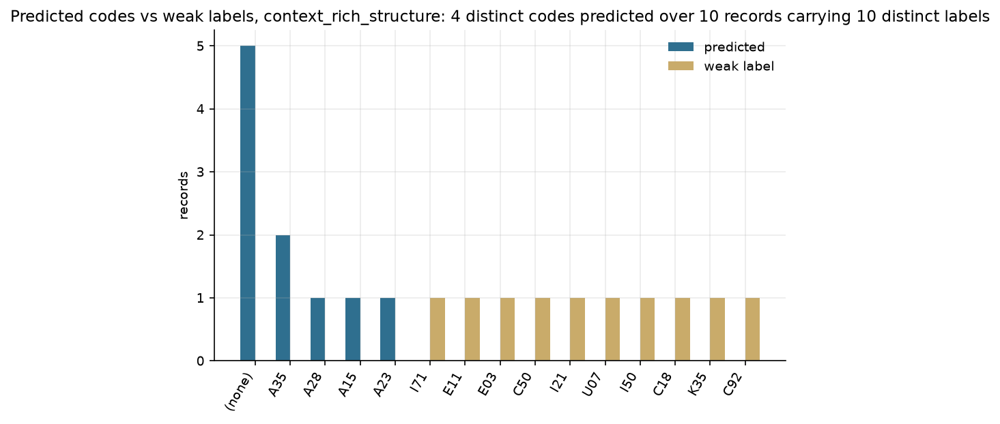

# Can prompt engineering make a 0.5B model assign ICD-10-AM diagnosis categories?

A methods study. It asks one narrow question and answers it with measurements:

> How far can prompt engineering alone take a small instruction-tuned language
> model (Qwen2.5-0.5B-Instruct, CPU inference) on assigning **three-character
> ICD-10-AM principal diagnosis categories** from a hospital course summary?

The short answer, measured rather than assumed: **not at all.** Nine prompting
strategies were run on a development split and five of them on a held-out test
split. Exact-match accuracy was 0.000 in all fourteen strategy-split
combinations, across 140 predictions. What prompt engineering did change was
*format validity*, which it moved across its entire range from 0.00 to 1.00 —
four strategies produced a perfectly well-formed category every single time and
were no more accurate than the one that produced none. The full tables are in
[Results](#results).

The more useful contribution is the **contamination check**: when a few-shot
prompt appears to improve accuracy, this pipeline tests whether the improvement
comes from codes the prompt itself displayed. Here it showed that both
strategies carrying six worked examples answered *exclusively* with codes from
their own prompts.

> **This is not a clinical coding tool.** It must not be used for real clinical
> coding, casemix classification, activity-based funding or billing. See
> [Scope and limitations](#scope-and-limitations).

---

## What ICD-10-AM is, and what a principal diagnosis code is

**ICD-10-AM** is the *International Statistical Classification of Diseases and
Related Health Problems, Tenth Revision, Australian Modification*. It is the
classification used to code diagnoses in Australian hospital morbidity data. It
adapts the World Health Organization's ICD-10 for Australian use, and it is
published together with the Australian Classification of Health Interventions
(ACHI, for procedures) and the Australian Coding Standards (ACS, the rules that
say how the classification must be applied).

Its disease codes are hierarchical. A code begins with a letter identifying the
chapter or block — `C` for malignant neoplasms, `I` for the circulatory system,
`J` for the respiratory system, and so on — followed by digits that narrow it
down:

| Level | Example | Meaning |
| --- | --- | --- |
| Chapter letter | `J` | Diseases of the respiratory system |
| Three-character category | `J44` | Chronic obstructive pulmonary disease |
| Four-character code | `J44.1` | COPD with acute exacerbation |
| Five-character code (AM-specific) | `J44.10` | Further Australian specificity |

This study predicts the **three-character category** only. That is a deliberate
simplification: it is the coarsest level that still carries real clinical
meaning, and it keeps the label space to roughly two thousand categories rather
than the roughly 14,000 four-character codes of ICD-10, which ICD-10-AM extends
further still. Even so, it is a very large multi-class problem.

The **principal diagnosis** is defined in the Australian Coding Standards as the
diagnosis established after study to be chiefly responsible for occasioning the
patient's episode of admitted care. Three things follow, and all three are
places where a naive model goes wrong:

- it is **one** condition, not a problem list;
- it is not necessarily the patient's most serious or most prominent problem —
  a patient with metastatic cancer admitted for a hip fracture has the fracture
  as the principal diagnosis;
- it is not the presenting symptom and not the procedure performed.

Real coding also requires sequencing rules, specificity rules and a great deal
of record-wide context. None of that is attempted here.

## Why a 0.5B model is a hard test

Qwen2.5-0.5B-Instruct has roughly half a billion parameters, is
general-purpose, and has no clinical or coding-specific pretraining. Setting it
against ICD-10-AM category assignment is a hard test by design, for four
reasons:

1. **Label space.** Even restricted to three characters this is a
   thousand-plus-class classification problem, with no shortlist supplied and
   no constraint forcing the output to be a real code.
2. **Memorisation, not structure.** Code-to-condition mappings are arbitrary
   lookups. `J44` means COPD for no reason derivable from language. A model
   either memorised the mapping during pretraining or it cannot produce it, and
   a 0.5B general model has very little of it memorised.
3. **Long clinical input, small context budget.** A discharge summary plus a
   context-rich prompt plus six worked examples consumes most of what the model
   can usefully attend to.
4. **No verifier.** Free-text generation can emit anything. `J52` and `M36` look
   exactly like codes and are not assigned categories in ICD-10. Nothing in the
   decoding process prevents that.

The point of choosing a hard setting is that it makes the *shape* of the failure
visible. A model that scores near zero but produces plausible-looking codes
tells you something specific about what prompt engineering can and cannot fix.

## Data

**Source:** [`starmpcc/Asclepius-Synthetic-Clinical-Notes`](https://huggingface.co/datasets/starmpcc/Asclepius-Synthetic-Clinical-Notes)
on the Hugging Face Hub — 158,114 rows built from synthetic discharge summaries.

The notes are **synthetic**: they were generated from public clinical case
reports, not extracted from a patient record system. No identifiable patient
data enters this repository, which is why the selected notes can be cached here
as plain JSONL. The dataset repeats each note across eight downstream NLP tasks,
so rows are deduplicated on note text.

### Split selection

Selection is fully determined by `icdprompt.data.ScanConfig` and its seed; no
record identifier is hardcoded anywhere. The rule, in order:

1. Read the first `scan_rows` rows of the `train` split in dataset order.
2. Deduplicate on note text.
3. Keep notes whose stated diagnosis section yields exactly one weak label (see
   below).
4. Keep notes whose redacted length is within `[min_chars, max_chars]`.
5. Shuffle the eligible pool with `random.Random(seed)`, take the first `dev_n`
   records as the **development** split and the next `test_n` as the **held-out
   test** split. They are disjoint by construction.

Record ids are the first twelve hex digits of the SHA-256 of the note text, so
they are stable across runs and independent of row order. The selected splits,
the label audit file and the exact configuration used are cached in `data/`, so
every re-run after the first is offline and reproducible.

### The labelling caveat — read this before reading any number

**The dataset ships no ICD-10-AM codes.** There is no gold standard here. The
labels used in this study are **weak labels**, derived as follows:

1. Each note's own **stated diagnosis section** is located by heading
   (`Diagnosis:`, `Discharge Diagnosis:`, `Admitting Diagnosis:`, `Final
   Diagnosis:` and similar).
2. An ordered, inspectable keyword table in `icdprompt/labeling.py` — around a
   hundred rules, each one regex plus one three-character category — is matched
   against that text.
3. A note is labelled **only** when exactly one distinct category fires. If two
   categories fire, the note is discarded: nothing in the record says which one
   a coder would have sequenced as principal.
4. A note is also discarded when the diagnosis section is a **problem list** of
   more than two enumerated conditions, for the same reason.
5. The matched text and the full stated diagnosis are written to
   `data/labels.jsonl` so that **every label in the study can be checked by
   eye**.

Then the critical step:

6. **The stated diagnosis section is redacted from the text given to the
   model.** The model sees the hospital course with `Discharge Diagnosis:
   [diagnosis section withheld]`.

Step 6 matters. Without it the task collapses into string matching — the model
would be reading the very sentence the label was derived from — and the reported
accuracy would measure label leakage rather than clinical inference.

**What these labels are not.** They are not clinical coding. They encode one
obvious category per condition from its name, applying none of the Australian
Coding Standards, no sequencing rules, no specificity rules and no record-wide
context. A qualified clinical coder would disagree with some of them, and
because every label ships with its evidence in `data/labels.jsonl`, the
disagreements are visible rather than hidden. Two real examples from the
current splits:

- Stated diagnosis *"1. Bronchial myelolipoma, confirmed through pathology.
  2. Obstructive pneumonia complicated by atelectasis of the right middle and
  lower lobes."* is labelled `J18` (pneumonia). A coder would plausibly sequence
  the myelolipoma as principal, with the pneumonia as an additional diagnosis.
- Stated diagnosis *"The patient had a history of comorbid diagnoses that
  included autism spectrum disorder, hypertension, hypothyroidism, and GERD…"*
  is labelled `E03` (hypothyroidism). That is a comorbidity list, not a
  principal diagnosis; the problem-list guard did not catch it because the
  conditions are in prose rather than enumerated.

Accuracy figures below are therefore *agreement with a transparent
weak-labelling rule*, not coding accuracy, and the label noise is one more
reason not to read small differences between prompt strategies as real.

## Prompt strategies

Nine strategies are registered in `icdprompt/prompts.py`. Each one carries its
rationale as a field on the template object, written before the experiment was
run, so the registry *is* the experimental design.

| Strategy | Family | Examples | Rationale |
| --- | --- | --- | --- |
| `zero_shot_minimal` | zero-shot | 0 | Baseline. The question asked in the plainest possible way, with no format contract, persona or examples. Everything else has to be measured against this. |
| `zero_shot_strict_format` | format-constrained | 0 | Tests whether the baseline's failures are formatting rather than knowledge. A hard output contract should raise format validity even if accuracy does not move. |
| `persona_clinical_coder` | persona | 0 | Tests whether role framing recruits more domain-appropriate behaviour. Persona prompting is widely claimed to help on professional tasks; this is the cheapest version of that claim to falsify. |
| `few_shot_three` | few-shot | 3 | In-context learning with three worked examples across three chapters. Also the first template where a correct answer may be a *copy* of a demonstrated code. |
| `few_shot_six` | few-shot | 6 | Doubles the demonstrations to six chapters, to separate learning the output format (should saturate fast) from learning the task (should keep improving if in-context learning is doing real work). |
| `cot_then_extract` | chain-of-thought | 2 | Tests whether an explicit reasoning chain before the answer helps. The risk on a small model is that reasoning tokens crowd out or drift from the answer, so extraction takes the *last* code rather than the first. |
| `context_rich_structure` | context-rich | 0 | Supplies the classification's structure in the prompt instead of relying on pretraining. If the model knows the condition but not the code system, a chapter-letter briefing should at least raise chapter agreement. |
| `json_output` | structured-output | 0 | Tests whether a machine-readable contract improves parseability. JSON is easy to validate but a small model may spend its budget on syntax or echo the schema back with the placeholder intact. |
| `hybrid_coder_structured` | hybrid | 6 | Combines every individually plausible component: coder persona, chapter briefing, principal-diagnosis definition, six demonstrations, hard single-line contract. If prompt engineering alone can carry this task, this is the template that should show it. |

Few-shot vignettes are **written by the author** for this study, not drawn from
the Asclepius dataset. That keeps the evaluation records unseen and lets the
contamination check use the demonstrated codes as a known shortlist.

## Metrics

| Metric | Definition | Why it is here |
| --- | --- | --- |
| `accuracy` | Exact agreement with the weak label. Unparsed output counts as wrong. | The headline number. |
| `format_validity` | Share of outputs from which a well-formed category could be extracted at all. | Separates "wrong answer" from "no answer". A template can score high here and zero on accuracy. |
| `chapter_agreement` | Share of records where the first character matches. | A much weaker bar; a model can know the body system without knowing the category. |
| `code_diversity` | Distinct predicted codes ÷ records. | Near zero means the model collapsed onto one or two favourite codes — the characteristic small-model failure on a large label space. |
| `example_echo_rate` | Share of well-formed predictions whose code the prompt's own few-shot block displayed. | Measures prompt-echoing directly. Unlike the contamination share it stays defined when accuracy is zero — which is the regime this study ended up in. |
| `contaminated_correct` | Correct predictions whose code the prompt's own few-shot block displayed. | The honest finding. These are the predictions that could be copying rather than coding. |
| `clean_accuracy` | Accuracy over only the records whose label is *not* a demonstrated code. | The fair comparison between a few-shot and a zero-shot template. |

Post-processing deserves its own note, because it is where a study like this
quietly goes wrong. `icdprompt/postprocess.py` extracts exactly one category
through four layers — bare output, JSON field, explicit answer cue, then a regex
scan — normalising case and truncating `J44.1` and `J440` to `J44`, and it
returns an explicit `VALID`/`INVALID` flag so that an unparsed answer is never
silently scored as a wrong answer. It also refuses known false friends:
`ICD-10-AM` must not parse as `D10`, `COVID-19` must not parse as `C19`,
`vitamin B12` must not parse as `B12`, and "a 72 year old man" must not parse as
`A72`. That last one was a real bug, found by a test.

## Results

### What was run

| | |
| --- | --- |
| Model | `Qwen/Qwen2.5-0.5B-Instruct`, float32, CPU |
| Decoding | greedy (`do_sample=False`), seed `20260321` |
| Splits | `ScanConfig(seed=20260321, dev_n=10, test_n=10, max_chars=2000)`, 10 development and 10 held-out test records drawn from an eligible pool of 2,464 notes |
| Coverage | all 9 registered strategies on the development split; the development winner plus 4 comparators on the held-out test split |
| Wall clock | 4 min 24 s end to end on an unloaded laptop, model download excluded |

### Development split (n = 10)

| Strategy | Examples | Accuracy | Format validity | Chapter agreement | Distinct codes | Modal code (share) | Echo rate |
| --- | --- | --- | --- | --- | --- | --- | --- |
| `zero_shot_minimal` | 0 | **0.000** | 0.50 | 0.00 | 3 / 10 | `D02` (0.30) | n/a |
| `zero_shot_strict_format` | 0 | **0.000** | 1.00 | 0.10 | 2 / 10 | `J44` (0.90) | n/a |
| `persona_clinical_coder` | 0 | **0.000** | 0.00 | 0.00 | 0 / 10 | none | n/a |
| `few_shot_three` | 3 | **0.000** | 1.00 | 0.00 | 3 / 10 | `N10` (0.70) | **0.90** |
| `few_shot_six` | 6 | **0.000** | 1.00 | 0.00 | 3 / 10 | `N10` (0.60) | **1.00** |
| `cot_then_extract` | 2 | **0.000** | 0.60 | 0.00 | 4 / 10 | `J44` (0.30) | **0.67** |
| `context_rich_structure` | 0 | **0.000** | 0.60 | 0.00 | 5 / 10 | `A23` (0.20) | n/a |
| `json_output` | 0 | **0.000** | 0.10 | 0.00 | 1 / 10 | `H42` (0.10) | n/a |
| `hybrid_coder_structured` | 6 | **0.000** | 1.00 | 0.10 | 3 / 10 | `S72` (0.70) | **1.00** |

### Held-out test split (n = 10)

The development stage ranks on accuracy, then format validity, then chapter
agreement. With accuracy tied at zero everywhere the tie-break selected
`zero_shot_strict_format`, which was carried to the test split together with four
comparators fixed in advance.

| Strategy | Examples | Accuracy | Format validity | Chapter agreement | Distinct codes | Modal code (share) | Echo rate |
| --- | --- | --- | --- | --- | --- | --- | --- |
| `zero_shot_strict_format` | 0 | **0.000** | 1.00 | 0.00 | 2 / 10 | `J44` (0.70) | n/a |
| `zero_shot_minimal` | 0 | **0.000** | 0.30 | 0.00 | 3 / 10 | `A28` (0.10) | n/a |
| `few_shot_six` | 6 | **0.000** | 1.00 | 0.00 | 3 / 10 | `N10` (0.60) | **1.00** |
| `context_rich_structure` | 0 | **0.000** | 0.50 | 0.00 | 4 / 10 | `A35` (0.20) | n/a |
| `hybrid_coder_structured` | 6 | **0.000** | 1.00 | 0.00 | 2 / 10 | `S72` (0.80) | **1.00** |

Echo rate is the share of well-formed predictions whose code the prompt's own
few-shot block displayed; a strategy with no examples has nothing to echo, so
`summary.csv` records 0 and the tables show n/a.

### Every code the model produced

| Strategy | Outputs across its 10 development records |
| --- | --- |
| `zero_shot_minimal` | no code ×5, `D02` ×3, `D03` ×1, `M25` ×1 |
| `zero_shot_strict_format` | `J44` ×9, `J52` ×1 |
| `persona_clinical_coder` | no code ×10 |
| `few_shot_three` | `N10` ×7, `J44` ×2, `N96` ×1 |
| `few_shot_six` | `N10` ×6, `S72` ×2, `C79` ×2 |
| `cot_then_extract` | no code ×4, `J44` ×3, `I21` ×1, `H30` ×1, `I39` ×1 |
| `context_rich_structure` | no code ×4, `A23` ×2, `A34` ×1, `A35` ×1, `A15` ×1, `A36` ×1 |
| `json_output` | no code ×9, `H42` ×1 |
| `hybrid_coder_structured` | `S72` ×7, `J44` ×2, `K35` ×1 |

| Strategy | Outputs across its 10 test records |
| --- | --- |
| `zero_shot_strict_format` | `J44` ×7, `J56` ×3 |
| `zero_shot_minimal` | no code ×7, `A28` ×1, `M76` ×1, `D65` ×1 |
| `few_shot_six` | `N10` ×6, `S72` ×3, `J44` ×1 |
| `context_rich_structure` | no code ×5, `A35` ×2, `A28` ×1, `A15` ×1, `A23` ×1 |
| `hybrid_coder_structured` | `S72` ×8, `J44` ×2 |



The three figures are drawn for the test split. The one above shows the
collapse and the chapter-A anchoring together: `context_rich_structure`
answered ten records carrying ten different labels with four codes, all from
chapter A, and failed to produce a code at all on five of them. Not one
prediction coincides with a label.

`figures/accuracy_vs_format_validity.png` is the headline in one picture — the
strategies spread along the format-validity axis from 0.30 to 1.00 and sit flat
on the zero-accuracy line. `figures/chapter_confusion.png` cross-tabulates true
against predicted chapter letters and has an empty diagonal.

### What the numbers say

**1. Accuracy is exactly 0.000 in all 14 strategy-split combinations.** Across
140 predictions the model never once named the category the weak-labelling rule
assigned — not on the development split, not on unseen test records, under no
prompting strategy. This is not a low score to be improved by tuning; it is a
floor.

**2. Prompt engineering moved format validity across its entire range and left
accuracy pinned at zero.** This is the central result. Format validity runs from
0.00 to 1.00 across the strategies:

| Format validity | Strategy | What the output looked like |
| --- | --- | --- |
| 0.00 | `persona_clinical_coder` | Adopted the `CODE:` contract and filled it with things that are not categories: `CODE: 3700`, `CODE: 234`, `CODE: M050000`. Nothing parsed, on any record. |
| 0.10 | `json_output` | Mostly malformed JSON — `{3,"H427.8"}` — or a well-formed object holding a non-code, `{"code": "A", "condition": "Stable"}`. |
| 0.30 – 0.50 | `zero_shot_minimal` | Answered in prose and usually named a condition rather than a code. |
| 0.50 – 0.60 | `context_rich_structure`, `cot_then_extract` | Reasoned at length, often without reaching a code. |
| 1.00 | `zero_shot_strict_format`, `few_shot_three`, `few_shot_six`, `hybrid_coder_structured` | A clean three-character category and nothing else, in four to eight generated tokens. |

Four strategies produce a perfectly formed category every single time, and they
are no more accurate than the one that produces none. **Format compliance and
task competence are independent here, and prompting buys the first cheaply
while leaving the second untouched.** Any evaluation that treated well-formed
output as evidence of competence would read this model as working.

**3. The failure is the code, not the clinical reading.** `zero_shot_minimal`
is the only strategy allowed to answer freely, and its prose shows it is often
following the note: one record is answered *"the ICD-10-AM principal diagnosis
code for this patient would be 'Colon Adenocarcinoma'"*, which is exactly the
condition the label was derived from. It identified the disease and then
substituted the disease name for a code, because it does not have the mapping.
Constraining the format does not install the mapping; it only hides the gap.

**4. Mode collapse, and no chapter-level signal either.** Each split holds ten
records carrying ten distinct weak labels. The strategies answered them with
between zero and five distinct codes — `zero_shot_strict_format` gave `J44` to
9 of 10 development records, `hybrid_coder_structured` gave `S72` to 8 of 10
test records. Chapter agreement never exceeds 0.10 in any of the 14 rows, which
is about what one favourite chapter letter would score by chance. There is no
evidence the model recognised the body system, let alone the category.

**5. Supplying the classification's structure changed what the model copied,
not what it knew.** `context_rich_structure` briefs the model on the chapter
letters, and that briefing opens with "A and B are infectious diseases". Every
one of its 11 well-formed predictions across both splits is a chapter-A code —
`A15`, `A23`, `A28`, `A34`, `A35`, `A36` — for records about colon
adenocarcinoma, melanoma, cholecystitis and aortic aneurysm. The model anchored
on the first letter in the list it had just been shown.

**6. The few-shot block acts as a menu, not as a lesson.** Both strategies
carrying six worked examples echo at **1.00 on both splits**: every well-formed
answer `few_shot_six` and `hybrid_coder_structured` produced was a code their
own prompt displayed. `few_shot_three` echoes at 0.90 and `cot_then_extract`,
with two examples, at 0.67. The pattern tracks the number of demonstrations.
Examples did not teach the task; they replaced the model's default guess with a
guess drawn from the prompt, and six of them narrowed its output space to the
prompt's contents entirely.

**7. The contamination counter is zero, and on the test split that is now a
real result rather than an absence.** `contaminated_correct` is 0 in all 14
rows, because nothing was correct and no correct answer could be a copy. On the
development split no label happened to coincide with a demonstrated code, so
the inflation mechanism had no opportunity to fire. **On the test split it
did:** two of the ten records carry labels that are among the six demonstrated
codes (`I21` and `K35`, hence `n_clean = 8`). A model echoing its prompt could
have scored on those two for free. It did not — it answered `N10` and `S72`.
The echoing is indiscriminate: it is not sensitive to the record at all, which
is precisely why it is worth measuring separately from accuracy.

**8. The development finding held on unseen records.** Every strategy carried
to the test split reproduced its development behaviour. Accuracy stayed at
zero. The three strategies that formatted perfectly did so again and kept the
same modal code — `J44`, `N10` and `S72` respectively — and both six-example
strategies echoed at 1.00 again. The two weaker formatters shifted a little
(`zero_shot_minimal` 0.50 → 0.30 validity, `context_rich_structure` 0.60 →
0.50) and changed modal code, though `context_rich_structure` stayed inside
chapter A. At ten records per split this is a consistency check rather than a
replication study, but the behaviour is at least not an artefact of the records
the strategies were selected on.

### Reading these numbers responsibly

Ten records per split is very small. It is enough to establish the two things
this study claims — that accuracy is zero and that well-formed output collapses
onto a few prompt-supplied codes — because both are unambiguous at this size
and consistent across two disjoint splits. It is **not** enough to rank
strategies against one another, to attach a confidence interval to any figure,
or to treat a 0.1 difference in format validity as meaningful. The labels are
weak labels from a keyword table, not clinical coding. See
[Scope and limitations](#scope-and-limitations).

## Why a small model fails at this

The measurements point at four separate causes, which matter because they call
for different remedies.

**Capacity.** Half a billion parameters is not enough to store an arbitrary
lookup table of thousands of code-to-condition mappings alongside everything
else the model does. There is no linguistic regularity to compress: nothing
about the string `J44` is derivable from "chronic obstructive pulmonary
disease". Chapter agreement was included precisely to detect a partial grasp —
a model that knew the body system but not the category would score here while
scoring zero on exact match. It did not: chapter agreement is 0.00 in twelve of
the fourteen rows and 0.10 in the other two. Even the coarsest level of the
classification, twenty-odd chapter letters, is not reliably available to this
model.

**No domain pretraining.** Qwen2.5-0.5B-Instruct is a general instruction model.
It has seen clinical text incidentally, not coding manuals, coded discharge
abstracts or the Australian Coding Standards. Prompt engineering can only
rearrange what the weights already contain; it cannot install knowledge that was
never there. This is the ceiling the persona and context-rich strategies run
into, and the measurements show it sharply. Told to act as a senior clinical
coder, the model adopted the register and emitted `CODE: 3700`. Briefed on what
the chapter letters mean, it returned chapter-A codes for melanoma and aortic
aneurysm, having anchored on the first letter in the briefing. A prompt can
tell the model to behave like a coder; it cannot give it a coder's knowledge,
and supplying the classification's structure as text is not the same as the
model having learned it.

**Label-space size.** Even the three-character restriction leaves a
thousand-plus-class problem. Random guessing is worth effectively nothing, and
the model has no mechanism for narrowing the field: it generates the next token,
not a choice from a candidate set. Unconstrained decoding also means a large
share of outputs are plausible-looking strings that are not assigned ICD
categories at all, which `format_validity` counts as valid (the shape is right)
while `accuracy` counts as wrong (the code does not exist).

**Few-shot codes as a menu.** A few-shot prompt hands the model a shortlist of
real codes in the right format, and the cheapest way for a weak model to
satisfy such a prompt is to return one of them. That is exactly what was
measured here: 90% of `few_shot_three`'s answers and 100% of `few_shot_six`'s
were codes their own prompts displayed. The examples did not teach the task;
they replaced the model's default guess with a guess drawn from the prompt.

The danger this creates is a reporting danger. On a split where some records
genuinely are `J44` or `N10`, a strategy that answers `N10` most of the time
starts collecting hits it did not earn, and its accuracy reads as evidence that
few-shot prompting works. Here it collected none: `contaminated_correct` is 0
in all fourteen rows, and that is reported as the zero it is rather than
dressed up as a finding.

The test split makes the point better than the development split can. Two of
its ten records carry labels that are among the six demonstrated codes, so a
prompt-echoing model had two free hits available — and missed both, answering
`N10` and `S72` to records labelled `I21` and `K35`. The echoing is
indiscriminate rather than targeted, which is why it has to be measured
separately: `example_echo_rate` catches it at zero accuracy, and
`contaminated_correct` and `clean_accuracy` are the columns that would catch it
on a split large enough for the coincidences to start paying. Any study of
few-shot prompting over a large label space needs this check; without it the
echoing is invisible and the accuracy is believed.

## What would actually be needed

Prompt engineering is the wrong tool for this problem. Three changes would
address the causes above directly, roughly in order of expected impact:

1. **A larger, domain-pretrained model.** Continued pretraining on clinical text
   and coded discharge abstracts, at a parameter count where arbitrary lookups
   can actually be stored, and ideally fine-tuned on coded episodes. This
   addresses capacity and domain knowledge, which are the binding constraints.
2. **Retrieval over the code index.** Rather than asking the model to recall a
   code, retrieve candidate categories from the ICD-10-AM tabular list and
   alphabetic index using the clinical terms found in the note, then ask the
   model to choose and justify one from that shortlist. This converts an
   open-ended generation problem into a ranking problem over a few dozen real
   candidates, and it makes the choice auditable — a coder can see which index
   entries were considered.
3. **Constrained decoding over valid codes.** Restrict generation to the set of
   assigned ICD-10-AM categories with a trie or grammar constraint. This cannot
   make a wrong answer right, but it eliminates the entire class of
   well-formed-but-nonexistent codes, so format validity stops being a separate
   failure mode and every output becomes a real category.

Beyond the model, anything intended for real use would need a proper reference
standard — episodes coded by qualified clinical coders, not a keyword table —
plus evaluation at the four- and five-character level, sequencing of additional
diagnoses, and the error analysis that casemix and funding consequences demand.

## Scope and limitations

- **This is a methods study, not a coding tool.** It must not be used for real
  clinical coding, casemix classification, activity-based funding or billing.
  Nothing in this repository has been validated for clinical or financial use,
  and the labels it is measured against are not a coding reference standard.
- Labels are **weak labels from a keyword table**, not qualified clinical
  coding. See [the labelling caveat](#the-labelling-caveat--read-this-before-reading-any-number).
- Notes are **synthetic**. Results need not transfer to real discharge
  summaries, which are longer, messier and less tidily structured.
- Splits are **small**, so differences between prompt strategies of a few
  records are not statistically meaningful. Confidence intervals are not
  reported because the sample sizes do not support them.
- Only the **three-character category** is predicted, and only the **principal**
  diagnosis. Real episodes carry additional diagnoses, procedures and
  sequencing.
- Evaluation is against a single model at a single size with greedy decoding.
  Nothing here speaks to what a larger or domain-adapted model would do.

## Repository layout

```
icd10am-llm-coding/
├── icdprompt/
│   ├── data.py            # seeded dataset loading, splitting, JSONL cache
│   ├── labeling.py        # transparent weak-label rules + diagnosis redaction
│   ├── prompts.py         # PromptTemplate dataclass + 9-strategy registry
│   ├── infer.py           # CPU inference with an on-disk generation cache
│   ├── postprocess.py     # single-category extraction with VALID/INVALID
│   └── evaluate.py        # metrics + the few-shot contamination detector
├── scripts/run_study.py   # dev stage, test stage, CSVs, figures
├── tests/                 # pytest: postprocess, prompts, labelling, metrics, data
├── data/                  # dev.jsonl, test.jsonl, labels.jsonl, scan_config.json
├── results/               # summary.csv, predictions.csv, raw/ generation cache
└── figures/               # the three figures
```

`data/labels.jsonl` is the audit file: one line per record giving the weak
label, the rule's matched text and the full stated diagnosis it came from.
`data/scan_config.json` records the exact selection parameters, and the loader
refuses a cached split whose configuration does not match the one requested.

## Reproducing

```bash
git clone https://github.com/itsgichia/icd10am-llm-coding.git
cd icd10am-llm-coding

python3.12 -m venv .venv
source .venv/bin/activate
pip install -r requirements.txt

pytest -q                      # the pipeline's own tests, no model needed
python scripts/run_study.py    # the study; downloads ~1 GB of model weights
```

The defaults (`--dev-n 10 --test-n 10 --max-chars 2000 --seed 20260321`) are the
settings the reported results were produced with, and `data/` ships the splits
those settings select, so the bare command reproduces them rather than silently
running a different experiment.

**The whole study takes 4 min 24 s** on an unloaded laptop once the weights are
downloaded — all nine strategies on the development split and five on the test
split, 140 generations, on CPU. There is no GPU step and nothing to configure.

Useful flags:

```bash
python scripts/run_study.py --dev-only                   # development stage only
python scripts/run_study.py --dev-n 24 --test-n 48       # larger; rebuilds the splits
python scripts/run_study.py --dev-templates json_output  # one strategy
python scripts/run_study.py --sample --temperature 0.7   # sampled instead of greedy
python scripts/run_study.py --figures-only               # redraw from existing CSVs
python scripts/run_study.py --batch-size 2               # less memory per batch
```

Decoding is **greedy by default**, which makes the study reproducible without
relying on seeded sampling. Every raw model output is cached under
`results/raw/`, keyed by model, template, record and decoding parameters, so
re-running the study, adding a template or fixing the post-processor costs
nothing for work already done. `results/raw/` is gitignored because it is large
and fully regenerable.

One implementation note worth passing on, because it is the difference between
the study taking minutes and taking hours on a memory-constrained machine:
generation passes `logits_to_keep=1`. Without it the prefill pass materialises
logits for *every* prompt position, and a batch of five 1,500-token prompts
against Qwen2.5's 151,936-token vocabulary is a 4.6 GB float32 tensor — enough
to push an 8 GB laptop into swap, where an identical batch can take forty times
longer. Only the final position is needed to pick the next token. If memory is
still tight, `--batch-size 2` trims the peak further.

## Author

**Gichia Muiruri** — MSc Health Data Science, UNSW Sydney

- LinkedIn: https://www.linkedin.com/in/gichia-muiruri
- GitHub: https://github.com/itsgichia

## Licence

MIT — see [LICENSE](LICENSE). Copyright (c) 2026 Gichia Muiruri.

The Asclepius synthetic clinical notes dataset and the Qwen2.5 model weights are
covered by their own licences on the Hugging Face Hub.
